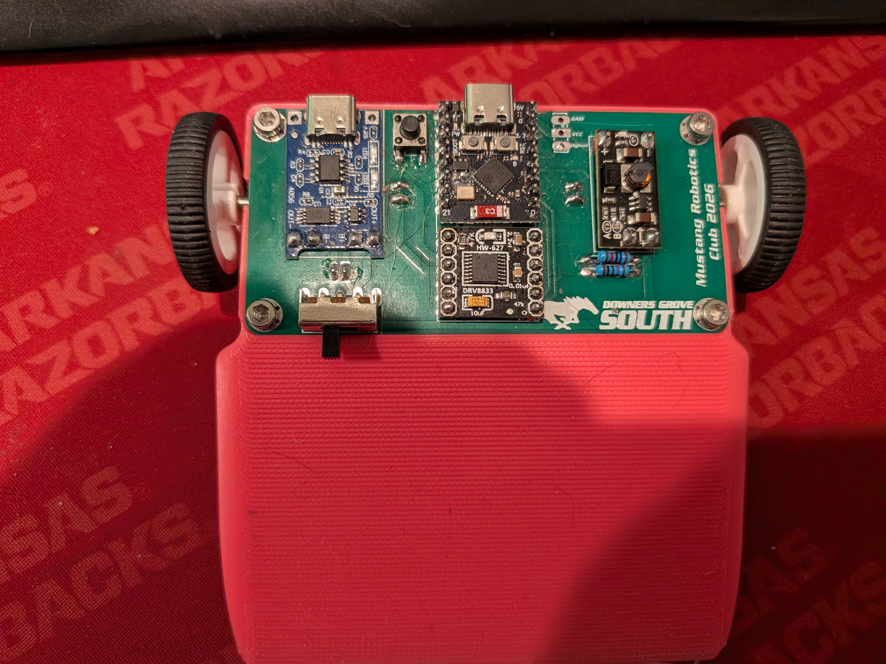
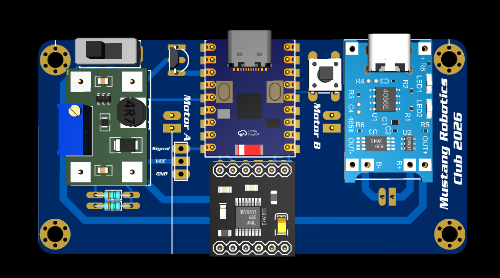

# ESP NOW CAR

An open-source, custom-designed remote-controlled (RC) car powered by the high-speed, low-latency **ESP-NOW** wireless protocol. 

Developed for high school STEM and robotics education, this project integrates a custom PCB mainboard, dual H-bridge motor drivers, 3D-printed chassis components, and custom N20 motor backplates into a rugged, modular robotics platform.

---

## 📸 Media & Hardware Gallery

### Assembled Chassis

### Custom N20 Motor Backplates

### Circuit Schematic

### PCB Layout & Dimensions

---

## 🛠️ Hardware & Prototype Status

* **Status:** Prototype & Testing Stage (Pre-production for classroom PCB manufacturing).
* **Microcontroller Testing:** Currently evaluating the **ESP32-C3 Zero** against the **ESP32-C3 Super Mini** to optimize Wi-Fi/ESP-NOW RF performance and signal stability before finalizing student PCB runs.
* **PCB Dimensions:** Custom double-sided board measuring **86.00mm x 42.00mm** designed in EasyEDA Pro.

---

## 📋 Bill of Materials (BOM)

| Component | Description | Qty |
| :--- | :--- | :--- |
| **Microcontroller** | ESP32-C3 Zero / Super Mini (Pinout verification in progress) | 1 |
| **Motor Drivers** | Dual H-Bridge Motor Driver Module (DRV8833 compatible) | 1 Set |
| **Motors** | N20 Micro Gear Motors with custom backplates | 2 |
| **Power Management** | TP4056 Li-Ion Charging Module (with battery protection) | 1 |
| **Voltage Regulation** | Mini DC-DC Step-Up (Boost) Converter Module | 1 |
| **Switch & Inputs** | Power Slide Switch & Tactile Bind Switch (`SW3`) | 1 Each |
| **Chassis** | Custom 3D-printed frame and wheels (PETG/TPU) | 1 Set |

---

## 📄 Specifications

| Document | Covers |
| :--- | :--- |
| [Car Firmware FSD](docs/Car_Firmware_FSD.md) | What the car firmware does, protocol, open items |
| [Car Hardware FSD](docs/Car_Hardware_FSD.md) | Car board V2–V4: power, pins, parts, open items |
| [Controller Firmware FSD](https://github.com/mustangwayrobots/ESP_NOW_Controller/blob/main/docs/Controller_Firmware_FSD.md) | Handheld controller firmware (separate repo) |
| [Controller Hardware FSD](https://github.com/mustangwayrobots/ESP_NOW_Controller/blob/main/docs/Controller_Hardware_FSD.md) | Handheld controller board (separate repo) |

---

## ⚡ Firmware Installation & Web Flashing

1. Connect your ESP32-C3 board to your computer via USB.
2. Open the browser-based [Firmware Flasher Portal](https://mustangwayrobots.github.io/ESP_NOW_CAR/flash/).
3. Pick your board version, click **Connect**, select the serial port, and install. Your saved pairing is kept.
4. The car and its controller must run matching firmware (same protocol version). After updating one, update the other too.

### Pairing

1. Hold **MENU** on the controller while switching it on, then let go.
2. Hold the **bind button** on the car while switching it on. Its LED blinks fast.
3. Both show success and restart. The pairing is saved and survives power-off and web flashing.

### Building in Arduino IDE

* **Board:** MakerGO ESP32 C3 SuperMini · **Core:** esp32 3.3.12 (Boards Manager)
* Open `ESP_NOW_CAR.ino`. Pick your board revision with the `#define HARDWARE_V2` line near the top (`V2`, `V3` or `V4`).
* No extra libraries are needed.

---

## 📁 Repository Layout

| Path | Contents |
| :--- | :--- |
| `*.ino`, `*.h` | The firmware (Arduino sketch). `Protocol.h` must match the controller repo's copy exactly. |
| `docs/` | Functional specifications and images |
| `flash/` | Web flasher page (GitHub Pages) |
| `.github/workflows/build.yml` | Builds every board version and publishes the flasher on each push |
| `CHANGELOG.md` | What changed, by date |
| `LICENSE` | MIT License |

---

## 📜 License

Released under the [MIT License](LICENSE).
