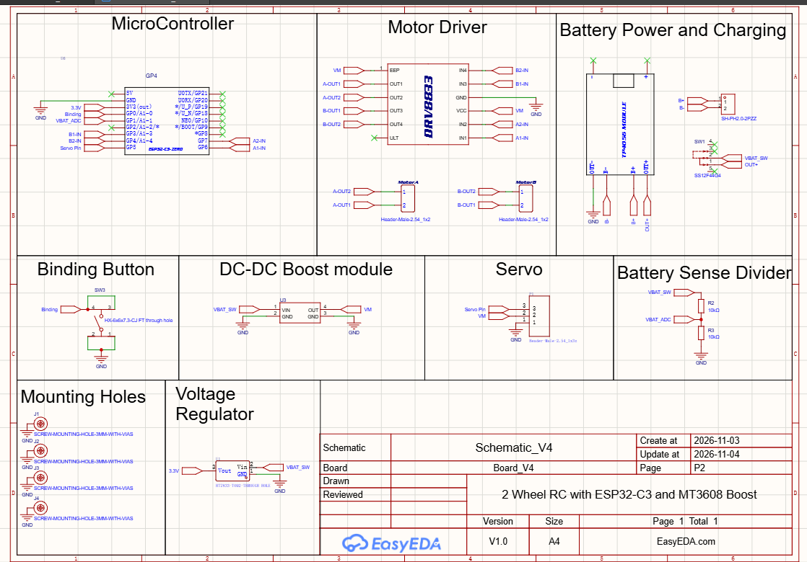
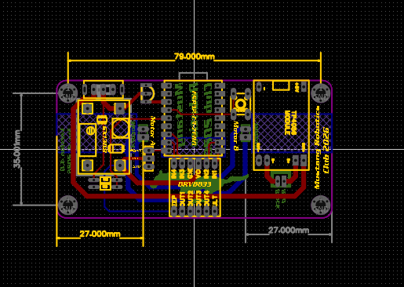

# ESP NOW CAR

An open-source, custom-designed remote-controlled (RC) car powered by the high-speed, low-latency **ESP-NOW** wireless protocol. 

Developed for high school STEM and robotics education, this project integrates a custom PCB mainboard, dual H-bridge motor drivers, 3D-printed chassis components, and custom N20 motor backplates into a rugged, modular robotics platform.

---

## 📸 Media & Hardware Gallery

### Assembled Chassis

### Custom N20 Motor Backplates

### Circuit Schematic

### PCB Layout & Dimensions

---

## 🛠️ Hardware & Prototype Status

* **Status:** Prototype & Testing Stage (Pre-production for classroom PCB manufacturing).
* **Microcontroller Testing:** Currently evaluating the **ESP32-C3 Zero** against the **ESP32-C3 Super Mini** to optimize Wi-Fi/ESP-NOW RF performance and signal stability before finalizing student PCB runs.
* **PCB Dimensions:** Custom double-sided board measuring **86.00mm x 42.00mm** designed in EasyEDA Pro.

---

## 📋 Bill of Materials (BOM)

| Component | Description | Qty |
| :--- | :--- | :--- |
| **Microcontroller** | ESP32-C3 Zero / Super Mini (Pinout verification in progress) | 1 |
| **Motor Drivers** | Dual H-Bridge Motor Driver Module (DRV8833 compatible) | 1 Set |
| **Motors** | N20 Micro Gear Motors with custom backplates | 2 |
| **Power Management** | TP4056 Li-Ion Charging Module (with battery protection) | 1 |
| **Voltage Regulation** | Mini DC-DC Step-Up (Boost) Converter Module | 1 |
| **Switch & Inputs** | Power Slide Switch & Tactile Bind Switch (`SW3`) | 1 Each |
| **Chassis** | Custom 3D-printed frame and wheels (PETG/TPU) | 1 Set |

---

## 📄 Specifications

| Document | Covers |
| :--- | :--- |
| [Car Receiver Firmware – Functional Specification](Car%20Receiver%20Firmware%20%E2%80%93%20Functional%20Specification.md) | What the car firmware does, protocol, open items |
| [Car Hardware – Functional Specification](Car%20Hardware%20%E2%80%93%20Functional%20Specification.md) | Car board V2–V4: power, pins, parts, open items |
| [Controller Firmware – Functional Specification](https://github.com/mustangwayrobots/ESP_NOW_Controller/blob/main/Controller%20Firmware%20%E2%80%93%20Functional%20Specification.md) | Handheld controller firmware (separate repo) |
| [Controller Hardware – Functional Specification](https://github.com/mustangwayrobots/ESP_NOW_Controller/blob/main/Controller%20Hardware%20%E2%80%93%20Functional%20Specification.md) | Handheld controller board (separate repo) |

---

## ⚡ Firmware Installation & Web Flashing

1. Connect your ESP32-C3 board to your computer via USB.
2. Open the browser-based [Firmware Flasher Portal](https://mustangwayrobots.github.io/ESP_NOW_CAR/flash/).
3. Click **Connect**, select the correct serial port, and flash the compiled binary directly in seconds.
