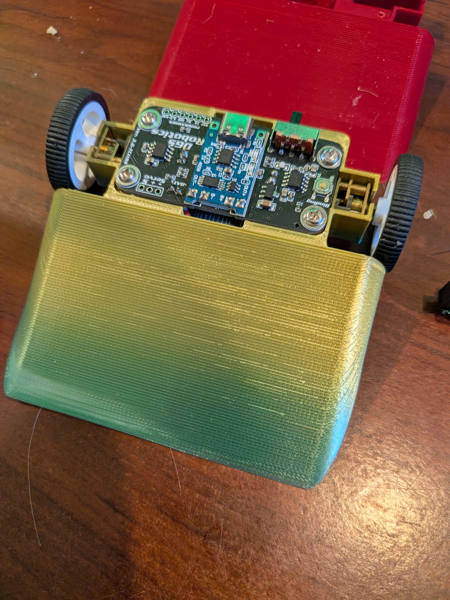
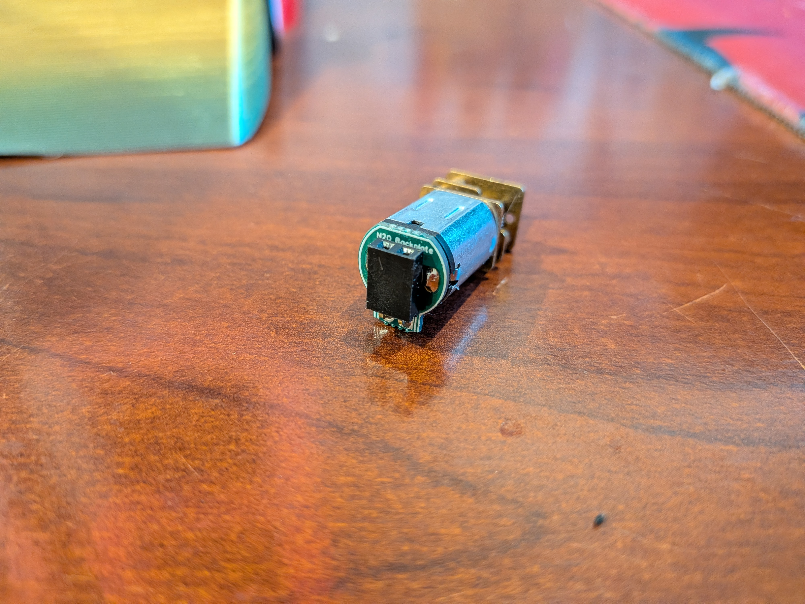
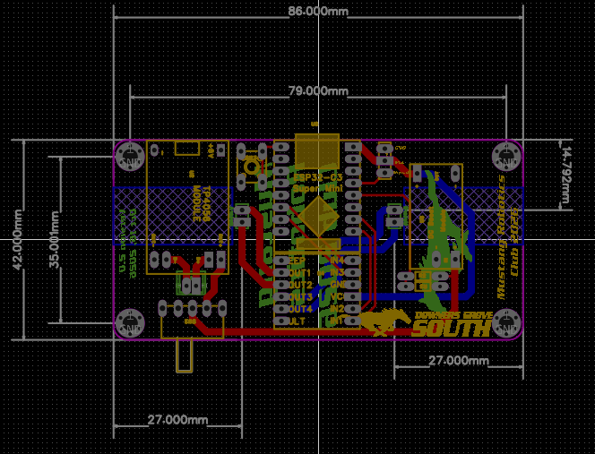

# ESP-NOW RC Car Platform

An open-source, custom-designed remote-controlled (RC) robot powered by Espressif's high-speed, low-latency **ESP-NOW** wireless protocol. Engineered specifically for robotics education and classroom racing, this platform pairs an **ESP32-C3 SuperMini** microcontroller with dual H-bridge motor control, custom N20 micro gear motors, an integrated battery charger, telemetry feedback, and web-based browser flashing.

---

## 📸 Technical Overview & Hardware Gallery

### 1. Assembled Robot Chassis
The chassis is constructed from high-impact 3D-printed PETG/TPU components designed to protect the internal PCB assembly during high-speed operation.

### 2. Custom N20 Motor Backplate Assembly
Custom backplates standardise the N20 micro gear motor interface, providing robust wire strain relief and direct pin access for quick field replacements.

### 3. PCB Dimension & Mechanical Layout
The system runs on a custom double-sided printed circuit board measuring **79.00mm × 35.00mm** (overall outline **86.00mm × 42.00mm**), formatted to mount flush onto standard 3mm mechanical chassis standoffs.

---

## 🔌 Circuit Architecture & Pinout Map

### Full Circuit Schematic (`Schematic_V4`)
The board integrates power routing, battery charging protection, step-up boost regulation, dual H-bridge driving, and ESP32-C3 signal lines into a unified system layout.

### GPIO Pin Mapping (ESP32-C3 SuperMini)

| Subsystem | Function Signal | ESP32-C3 GPIO | Hardware Configuration Details |
| :--- | :--- | :--- | :--- |
| **Status LED** | System Indicator | `GPIO 8` | Active-LOW onboard status LED |
| **Motor Driver A** | Motor A Input 1 (`A1Pin`) | `GPIO 1` | 5 kHz Hardware PWM (Channel A Forward) |
| **Motor Driver A** | Motor A Input 2 (`A2Pin`) | `GPIO 0` | 5 kHz Hardware PWM (Channel A Reverse) |
| **Motor Driver B** | Motor B Input 1 (`B1Pin`) | `GPIO 20` | 5 kHz Hardware PWM (Channel B Forward) |
| **Motor Driver B** | Motor B Input 2 (`B2Pin`) | `GPIO 10` | 5 kHz Hardware PWM (Channel B Reverse) |
| **Servo / Weapon** | Auxiliary Weapon Servo | `GPIO 4` | 50 Hz Hardware Servo PWM (16-bit Duty Mapped) |
| **System Control**| Binding Mode Button | `GPIO 5` | Tactile Switch (`SW3`) with internal `PULLUP` |
| **Telemetry** | Battery Voltage Divider | `GPIO 3` | Analog Input (`VBAT_ADC`) via 10k/10k divider |

---

## 🛒 Bill of Materials (BOM)

| Component | Designator / Part | Quantity | Operational Purpose |
| :--- | :--- | :--- | :--- |
| **Microcontroller** | ESP32-C3 SuperMini / Zero | 1 | Main logic processor and 2.4 GHz RF node |
| **Motor Driver** | DRV8833 H-Bridge Breakout Module | 1 | Dual DC motor speed/direction driver |
| **Motors** | N20 Micro Gear Motors (6V 300-500 RPM) | 2 | Primary differential drive wheels |
| **Battery Charger** | TP4056 USB-C Charging Module | 1 | LiPo/Li-ion 1S charge manager with protection |
| **Boost Converter** | MT3606 / Mini DC-DC Step-Up Module | 1 | Steps 3.7V LiPo voltage up to 5V rail |
| **Resistors** | 10kΩ 0805 SMD / Through-Hole | 2 | Voltage divider network ($R_2, R_3$) for battery monitoring |
| **Switches** | SS12F44 Slide Switch (`SW1`) | 1 | Main system power toggle switch |
| **Switches** | 6x6x7.3mm Tactile Pushbutton (`SW3`) | 1 | Dedicated hardware pair/binding initiator switch |

---

## 🚀 Getting Started & Firmware Installation

### Option 1: Browser-Based Flashing (Recommended)
This repository includes automated Web-USB build actions. You do not need to install Arduino IDE or compile code manually to flash a chassis:

1. Connect the ESP32-C3 SuperMini to your PC via a USB-C cable.
2. Open Chrome or Edge and navigate to the **[Web Firmware Flasher Portal](https://mustangwayrobots.github.io/ESP_NOW_CAR/)**.
3. Click **Connect**, select the serial port for your ESP32-C3, choose your hardware revision (e.g., `HARDWARE_V4`), and click **Program**.

### Option 2: Compiling via Arduino IDE
1. Install **Arduino IDE** (v2.0+ recommended) and add the ESP32 board support package (`esp32` by Espressif).
2. Select target board: **ESP32C3 Dev Module**.
3. Open `ESP_NOW_CAR.ino`.
4. Ensure `HardwareConfig.h` has the appropriate hardware flag active (`#define HARDWARE_V4`).
5. Press **Upload**.

---

## 🎮 Pairing (Binding) Procedure

1. **Enter Binding Mode:** With the car turned off, press and hold the **Binding Button** (`SW3`). Power on the car while holding the button. The status LED will flash rapidly.
2. **Pairing Handshake:** Turn on your remote controller in binding mode. The car will capture the remote's unique MAC address, store it permanently to non-volatile flash memory (NVS), confirm the connection, and reboot.
3. **Normal Driving:** The car will boot directly into normal driving mode, binding exclusively to your assigned controller.